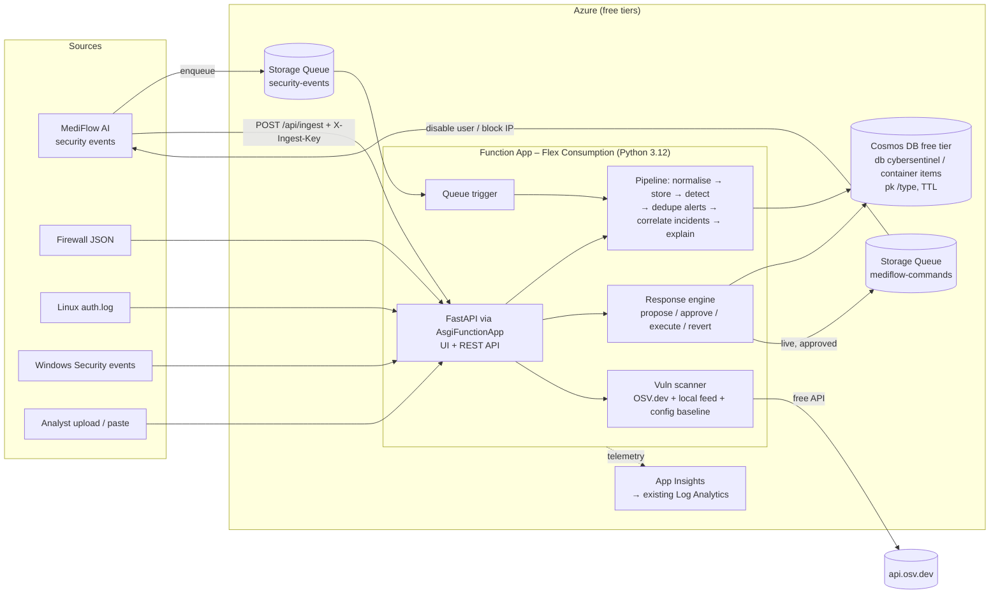

# CyberSentinel AI – Architecture

## Design decisions

| Decision | Why |
|---|---|
| **Functions Flex Consumption** instead of Container Apps | No container registry is needed (ACR Basic is paid), it scales to zero, and the monthly free grant covers demo traffic. FastAPI runs unchanged via `AsgiFunctionApp`. |
| **Cosmos DB free tier**, one container partitioned by `/type` | 1000 RU/s and 25 GB are free. Most queries are single-partition (`type = 'alert'`, and so on). Logs carry a `ttl` of 30 days so storage stays small. |
| **Storage Queues** instead of Service Bus | They reuse the existing storage account, cost fractions of a cent, and Functions has native identity-based triggers. |
| **No LLM** | The explainer is deterministic natural-language generation from detection metadata and MITRE mappings. Its output is reproducible, testable, free, and cannot hallucinate. |
| **UI served by the same Function** | Static Web Apps isn't allowed in this subscription's regions. Same-origin serving also means no CORS, and a strict CSP (`default-src 'self'`). |
| **Managed identity** | Cosmos DB (`disableLocalAuth=true`) and Queues use Entra ID RBAC. No connection strings in code. |

## Data model (container `items`, partition key `/type`)

| type | Key fields |
|---|---|
| `log` | timestamp, source, event_type, user, ip, host, outcome, dst_port, roles, resource, details, ttl |
| `alert` | rule_id, rule_name, severity, mitre[], entity_type, entity, evidence[], count, first_seen, last_seen, extra, status, incident_id, dedupe_key |
| `incident` | title, severity, status, entity_type, entity, alert_ids[], mitre[], explanation{}, assigned_to, notes[] |
| `action` | incident_id, kind, target, target_system, dry_run, status, requested_by, approved_by, result, history[] |
| `asset` | name, kind, owner, criticality, packages[], config{}, last_scan{findings, risk_score, rating} |
| `ioc`, `blocklist`, `user`, `audit` | supporting data |

## Detection pipeline

1. **Normalise** each raw event (unknown formats are skipped and counted).
2. **Store** the events, then load the detection window: from 60 minutes before the earliest new event onwards. For anomaly baselines, load the same users' events from the last 7 days.
3. **Run detectors.** Each returns hits with evidence log IDs. A hit only raises or updates an alert if it includes at least one *newly ingested* event, which prevents duplicate alerts on re-runs.
4. **Dedupe** on `rule|entity_type|entity` while an alert is open, merging the evidence.
5. **Correlate** into an open incident for the same entity, or the attacker-IP incident for a compromised user. Then recompute severity and title and regenerate the explanation.

## Response safety model

- Actions default to **dry-run**. Live execution requires an explicit `dry_run=false`.
- **Two-person rule:** the requester cannot approve their own action, and only Admin or SecurityLead can approve or execute.
- MediFlow refuses to auto-disable Admin accounts. Every action except password reset can be reverted.
- Every step is appended to `action.history` and to the global audit log.

## Thresholds

`app/domain/detection.py → THRESHOLDS`, for example: brute force ≥5 failures in 10 minutes; spray ≥4 accounts in 10 minutes; scan ≥10 ports in 5 minutes; anomaly z ≥ 3 with ≥15 events per hour and ≥5 baseline hours.
